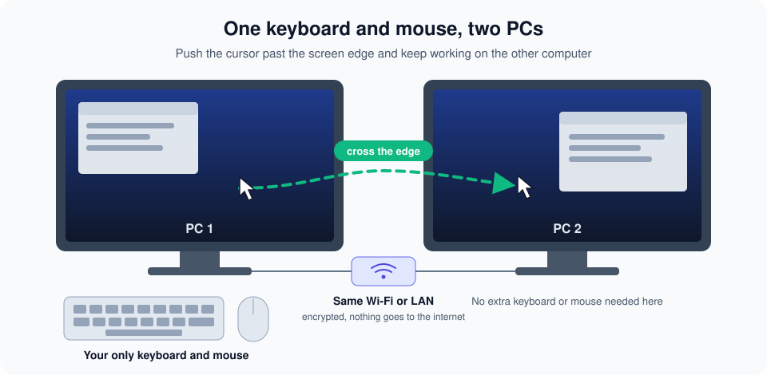

# MouseKey LAN

Use **one keyboard and mouse** for several Windows PCs on the same Wi-Fi or wired network.
Move the cursor past the edge of one screen and it continues on the next computer, and your
typing follows it. Free and open source, inspired by Mouse Without Borders and Synergy.



## How it works

1. Install MouseKey LAN on **every** PC you want to use.
2. The PCs find each other on your network. You **pair** them once, confirming a 6-digit code.
3. You tell the app where the screens sit on your desk (for example, PC 2 is to the right of
   PC 1).
4. From then on, the keyboard and mouse of whichever PC you're sitting at drive all of them:
   push the cursor off the shared edge and you're on the other PC.

Everything stays on your network. The PCs talk to each other directly with end-to-end
encryption; nothing goes through the internet or a server.

## Features

* Seamless edge switching with a drag-and-drop **monitor layout** (mixed resolutions, multiple
  monitors, any arrangement, 3 or more PCs)
* Mouse moves, all buttons, vertical and horizontal scrolling, keyboard and shortcuts (scan
  codes, so keyboard layouts don't matter)
* Automatic **discovery** on the network, plus pairing by IP address, link or QR code
* **Mutual pairing approval** with a 6-digit verification code, and end-to-end **encryption**
  (Noise XX: X25519 / ChaCha20-Poly1305)
* **Shared clipboard** (text and images), **copy and paste files** between PCs, and **drag and
  drop** files across the screen edge (saved to `Downloads\MouseKey LAN` on the other PC)
* Starts at sign-in, lives in the tray, **reconnects** by itself after network drops, sleep,
  lock and restart
* Optional **lock-screen control**: type your password on a locked PC from another PC's
  keyboard
* Stuck-key protection, and the **Ctrl+Alt+Home** hotkey to bring control back
* Diagnostics: latency, connection quality, hook timing, CPU and memory use

## Quick start

### 1. Install on each PC

1. Download `MouseKey.LAN_<version>_x64-setup.exe` from the
   [latest release](https://github.com/krunal30122001/mousekey-lan/releases/latest) and run it
   on every PC.
   * Windows SmartScreen may say *"Windows protected your PC"* because the installer isn't
     code-signed yet. Click **More info → Run anyway**.
   * Approve the administrator prompt. The installer adds a Windows Firewall rule for the app.
2. MouseKey LAN opens and from then on starts automatically when you sign in. It keeps running
   in the system tray when you close its window.

Requirements: Windows 10 (1809 or later) or 11, x64. All PCs must be on the **same network**
(the same Wi-Fi or the same router, or a mix of Wi-Fi and cable on that router).

### 2. Pair the PCs (once)

1. On the PC you're sitting at (**PC 1**), open **Pair devices**. The other PC (**PC 2**)
   appears under **Computers on this network**.
   * Not listed? Type PC 2's IP address instead. It's shown on PC 2's **Pair devices** page.
2. Click **Pair** next to PC 2.
3. PC 2 shows a request with a 6-digit code. Check that PC 1 shows the **same code**, then click
   **Codes match, approve** on PC 2.

Paired PCs remember each other and reconnect by themselves from now on.

### 3. Arrange the screens

1. Open **Monitor layout**. Each PC's screens are shown as boxes.
2. Drag the boxes to match your desk: if PC 2's monitor is to the right of PC 1's, place it on
   the right.
3. Click **Save layout**. The layout is shared with the other PCs automatically.

### 4. Use it

* **Switch PCs:** move the mouse off the screen edge where the two PCs touch. The cursor
  appears on the other PC, and your keyboard types there.
* **Come back:** move back across the same edge, or press **Ctrl+Alt+Home** at any time.
* **Copy and paste:** copy text, an image or files on one PC, move to the other and paste.
* **Drag files:** drag files to the screen edge and drop them on the other PC.

Tip: the corners of the screen are ignored on purpose, so reaching for Start or a window's
close button doesn't switch PCs (**Settings → Input & switching**).

## Troubleshooting

| Problem | What to do |
|---|---|
| The other PC isn't listed | Make sure both PCs are on the same network and MouseKey LAN is running on both. Pair by IP address instead, and check that no firewall or antivirus blocks the app (TCP port 47820). |
| The mouse feels slow or jumpy | Wi-Fi is usually the cause. A network cable, or 5 GHz Wi-Fi instead of 2.4 GHz, makes it much smoother. **Connection diagnostics** shows the delay. |
| Typing doesn't work in some windows | Windows blocks input into programs running as administrator. Turn on **Settings → Security → Run as administrator** on the PC you control. |
| The PC locked and I can't type the password | Turn on **Run as administrator** and **Lock-screen control → Install service** on that PC (see below). |
| The cursor is stuck on the other PC | Press **Ctrl+Alt+Home**. |

## Lock screen

By default, when a PC you control locks, control returns to your own PC, and you unlock it with
its own keyboard. To type the password from another PC instead, install the optional
**lock-screen service** on the PC you want to unlock: **Settings → Security → Lock-screen
control → Install service** (it also needs **Run as administrator**). See
[docs/LOCKSCREEN.md](docs/LOCKSCREEN.md) for how it works and its security trade-offs.

## Known limitations (Windows security boundaries)

* The **sign-in screen** after signing out, **UAC prompts** and **Ctrl+Alt+Del** can't be
  controlled remotely. See [docs/PLATFORM.md](docs/PLATFORM.md) for the research and options.
* Without the lock-screen service, a locked PC can't be controlled remotely.
* After a reboot, sharing starts once a user is signed in on that PC.
* Windows only, for now.

## Build from source

Prerequisites: Rust (stable, MSVC), Node.js 20+, Visual Studio Build Tools (C++), WebView2.

```bash
npm install
npm run tauri dev        # development with hot reload
npm run tauri build      # release: target/release/bundle/nsis/*-setup.exe
cargo test --workspace --exclude mousekey-lan
```

`npm run tauri build` bundles the lock-screen service, so build it first with
`cargo build --release -p mkl-service`.

Logs are written to `%APPDATA%\com.mousekeylan.app\logs\mousekey.log` (`MKL_LOG=debug` for more
detail).

## Documentation

* [docs/ARCHITECTURE.md](docs/ARCHITECTURE.md): crates, hot path, control model, layout, protocol
* [docs/SECURITY.md](docs/SECURITY.md): threat model and pairing
* [docs/LOCKSCREEN.md](docs/LOCKSCREEN.md): the optional lock-screen service
* [docs/PLATFORM.md](docs/PLATFORM.md): Windows permissions, lock screen and pre-login research, macOS/Linux plan
* [docs/TESTING.md](docs/TESTING.md): automated tests, manual test matrix, performance targets

## License

[MIT](LICENSE). Free to use, change and share. Copyright (c) 2026 Immersive Mobile Designs.
